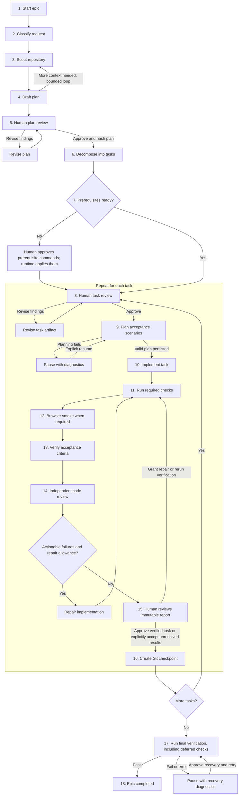

# Epic workflow

An epic runs tasks sequentially, with human approval before implementation and after verification. See [Deterministic Pi epic](pi-epic.md) for configuration, commands, and artifact details.

| Step | Description |
| --- | --- |
| 1. Start epic | `/epic <epic>` creates the run and saves the request in `Epic.md`. |
| 2. Classify request | Establish the epic's scope and execution context. |
| 3. Scout repository | Gather read-only evidence about the code, constraints, and available checks. |
| 4. Draft plan | Write the run's `plan.md`; request focused scouting if evidence is missing. |
| 5. Human plan review | Resolve `R:` comments through revision; `/plan-approve` validates and hashes the approved plan. |
| 6. Decompose into tasks | Task Planner turns the approved plan into ordered task artifacts with criteria and check policies. |
| 7. Prepare prerequisites | Detect missing Git setup or dependencies; execute proposed commands only after `/epic-approve-prerequisites`. |
| 8. Human task review | Review the task artifact, refine `R:` findings, and run `/task-approve` before implementation. |
| 9. Plan acceptance scenarios | Independently freeze criteria and persist scenarios before code changes; invalid plans receive bounded corrections. |
| 10. Implement task | The writable, sandboxed Implementer makes the approved changes. |
| 11. Run required checks | Run task-required checks through fast/full suites; record deferred checks for final verification. |
| 12. Browser smoke | When required, supervise the approved development server and browser; check readiness and runtime errors. |
| 13. Verify acceptance | Execute planned scenarios and collect evidence for each criterion, including human-only obligations. |
| 14. Independent code review | Review the implementation and evidence; actionable failures trigger repairs while shared allowances remain. |
| 15. Human results review | Inspect the immutable report; approve verified work, accept the report after manual review or acceptance of known limitations, or grant repairs. Exit hides the dashboard and leaves the task awaiting review. |
| 16. Create checkpoint | Record accepted task changes in Git, then advance to the next task. |
| 17. Final verification | Run repository-wide checks, including checks deferred by individual tasks; failures require recovery approval. |
| 18. Complete epic | Mark the epic completed after final verification passes. |

Repair attempts, infrastructure retries, and verification time share task-wide limits. At the results checkpoint, `/epic-resume` reruns verification with the remaining allowance; `/task-repair` explicitly adds one repair attempt and five minutes. Acceptance criteria remain frozen for the task.

The diagram shows the main path and key loops. Operational errors elsewhere also pause with diagnostics or a task report instead of silently advancing. State, events, evidence, and reports persist under `.pi/epics/runs/<epic-id>/`; `/epic-status` shows the pending action, and `/epic-exit` only hides the dashboard.

Source: [epic orchestration](../pi/extensions/epic/machines/epic-machine.ts), [task execution](../pi/extensions/epic/machines/task-execution-machine.ts), and [verification loop](../pi/extensions/epic/verification-runner.ts).
