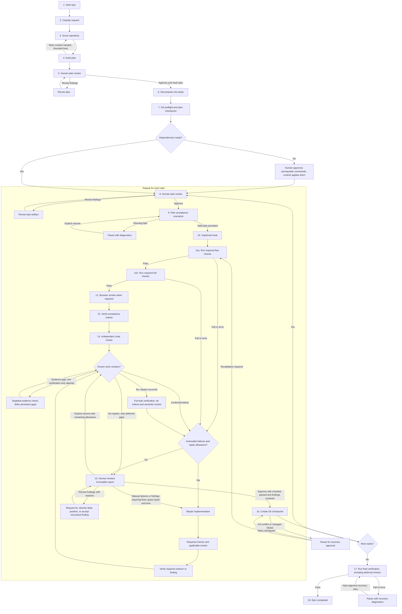

# Epic workflow

An epic runs tasks sequentially, with human approval before implementation and after verification. See the [configuration example](../pi/epic.config.example.json) and [command definitions](../pi/extensions/epic/commands.ts) for the available settings and commands.

| Step | Description |
| --- | --- |
| 1. Start epic | `/epic <epic>` creates the run and saves the request in `Epic.md`. |
| 2. Classify request | Assign a complexity label: `complex` if the request contains “migration” (case-insensitive), otherwise `simple` for fewer than 140 characters or `moderate`. |
| 3. Scout repository | Gather read-only evidence about the code, constraints, and available checks. |
| 4. Draft plan | Write the run's `plan.md`; request focused scouting if evidence is missing. |
| 5. Human plan review | Resolve `R:` comments with `/plan-review`; `/plan-revise` forces a revision. `/plan-approve` requests revision when findings remain, otherwise validates and hashes the approved plan. |
| 6. Decompose into tasks | Task Planner turns the approved plan into ordered task artifacts with criteria and check policies. |
| 7. Prepare prerequisites | Require an existing Git worktree and configured identity, ensure diagnostic artifacts are untracked, prepare ignore rules, discover missing dependencies, and create the plan checkpoint. Execute proposed prerequisite commands only after `/epic-approve-prerequisites`. Git preflight failures enter recovery before prerequisite discovery. |
| 8. Human task review | Review the task artifact, refine `R:` findings with `/task-review`, and run `/task-approve` before implementation. Approval with unresolved `R:` findings requests revision instead. Task revisions preserve acceptance criteria. |
| 9. Plan acceptance scenarios | Freeze the approved task criteria and have an independent Verification Planner persist validated scenarios before implementation. It plans checks without executing verification or changing code; invalid JSON or scenario contracts receive bounded corrections. Invocation, timeout, storage, and persisted-criteria failures pause immediately. |
| 10. Implement task | The writable, sandboxed Implementer makes the approved changes. |
| 11. Run required checks | Run task-required fast checks, then full checks. A failed suite blocks later verification stages and triggers repair when actionable and within allowance; otherwise present the human report. Every repair restarts at fast checks, then full checks and applicable browser smoke before targeted verification. A prerequisite failure gates later stages and takes priority in the repair queue. Record deferred checks for final verification. |
| 12. Browser smoke | When `browser-smoke` is required or scenarios need a browser, launch and supervise the Implementer's declared development server and the runtime browser; check readiness and runtime errors. Close both after browser verification. |
| 13. Verify acceptance | Execute planned command and scripted browser scenarios. For `agent_browser` obligations, an independent Verifier explores through a runtime browser bridge and records target-specific observations and an explicit self-check before concluding. The initial full pass collects evidence for every criterion. Repair one failing criterion at a time and recheck all obligations belonging to that criterion; keep other criteria queued. Missing evidence, inconclusive results, and likely failures receive one targeted verification-only attempt per round. New browser conclusions from targeted verification receive focused independent evidence review before acceptance; incomplete inspection remains an explicit evidence gap. Confirmed defects may enter the repair queue; persistent uncertainty is deferred while other repairs continue. Human-only obligations remain for human review. After all known work is resolved or deferred, run a comprehensive final task pass only if repairs occurred, including previously passed and unresolved criteria. A final pass does not consume repair allowance, still shares the task deadline, and does not start another evidence-only retry loop. |
| 14. Independent code review | Review the implementation and independently inspect raw browser evidence against the Verifier’s claims; Actionable findings become separate repair items while shared allowances remain; their targeted checks use focused review. Repeat the full review during the final task pass. Final-pass regressions start another repair round, followed by another full task pass. Verification runs do not consume repair attempts; each implementer invocation does. |
| 15. Human results review | After queued repairs and final task verification finish, inspect one consolidated immutable report, review failures with explicit reasons, and record manual checklist results. Persistent evidence gaps do not interrupt other repair work. Exhausted allowance, deadline, cancellation, or blocking infrastructure may produce an incomplete report with the remaining work and pending final verification explicitly recorded. Continue requests fixes for remaining actionable failures or failed manual steps. Approval requires every manual step to pass and blocking findings to be resolved; incomplete automated evidence can be confirmed manually. Unchecked steps or unresolved likely failures block approval. `/task-repair` grants repairs. Exit hides the dashboard and leaves the task awaiting review. |
| 16. Create checkpoint | Validate the task delta and acceptance of the current report, record accepted task changes in Git, then advance to the next task. Git conflicts or unexpected HEAD changes pause for recovery approval; when recovery requires revalidation, rerun verification and human results review before retrying the checkpoint. |
| 17. Final verification | This epic-wide stage is separate from the final full pass for a repaired task. Run repository-wide checks, including checks deferred by individual tasks; failures require recovery approval. |
| 18. Complete epic | Mark the epic completed after final verification passes. |

## Commands by workflow state

| Workflow state | Command or dashboard action | Purpose |
| --- | --- | --- |
| No active epic | `/epic <epic>` | Start a new epic from the request. |
| Plan review | `/plan-review` | Revise the plan using its `R:` comments. |
| Plan review | `/plan-revise` | Request another plan revision. |
| Plan review | `/plan-approve` | Approve the plan, or request revision if `R:` findings remain. |
| Prerequisite approval | `/epic-approve-prerequisites` | Apply the proposed repository setup commands. |
| Task planning review | `/task-review` | Revise the task using its `R:` findings. |
| Task planning review | `/task-approve` | Approve the task for implementation, or request revision if findings remain. |
| Acceptance planning paused | `/epic-resume` | Retry acceptance planning. |
| Results review | Manual checklist; **Review failures** | Record manual results and decide which findings need fixes. |
| Results review | **Continue** | Approve a completed review, or request repairs for recorded failures. |
| Results review | `/task-approve` | Approve after the manual checklist passes and blocking findings are resolved. |
| Results review | `/task-repair` | Grant one repair attempt and five additional minutes for recorded failures; takes no arguments. |
| Results review | `/epic-resume` | Resume queued verification with the remaining allowance; a finished queue starts fresh full verification. Interrupted repairs are not repeated without an explicit additional grant. |
| Recovery approval | `/epic-approve-recovery` | Approve the proposed recovery and retry the affected step. |
| Escalated run | `/epic-resume` | Retry task execution after addressing the reported problem. |
| Any persisted run | `/epic-status` | Show the current state and pending action. |
| Any persisted run | `/epic-resume` | Resume the saved run and show the dashboard; behavior depends on the current state. |
| Dashboard visible | `/epic-exit` | Hide the dashboard without changing the run state. |

Source: [epic orchestration](../pi/extensions/epic/machines/epic-machine.ts), [task execution](../pi/extensions/epic/machines/task-execution-machine.ts), [services](../pi/extensions/epic/services.ts), [acceptance planning](../pi/extensions/epic/acceptance-planning.ts), [verification loop](../pi/extensions/epic/verification-runner.ts), [human decisions](../pi/extensions/epic/verification-decisions.ts), [finding decisions](../pi/extensions/epic/failure-review.ts), [approval policy](../pi/extensions/epic/task-review-policy.ts), and [dashboard submission](../pi/extensions/epic/dashboard/manual-review-submission.ts).

## Verification persistence

Task verification ledgers use format version 2 to record full versus targeted cycles, queue progress, deferred evidence gaps, and repair invocation links. Format-1 and older ledgers are incompatible and are rejected explicitly; no automatic migration is performed. Completed repairs are not repeated when resuming their verification. Targeted evidence after code repairs remains provisional until a complete full task pass; reports retain the original provenance of observations and never turn historical passes into fresh evidence. Evidence-only retries can supplement a full pass on unchanged code without an extra full pass, after independently reviewing replacement browser evidence. Problems carry their stage and affected obligations; successful retries supersede only errors from the stages and obligations they actually recheck. Full semantic review, focused evidence reviews, original browser probes, and historical problems retain their provenance. Human review and explicit acceptance policies remain unchanged.
