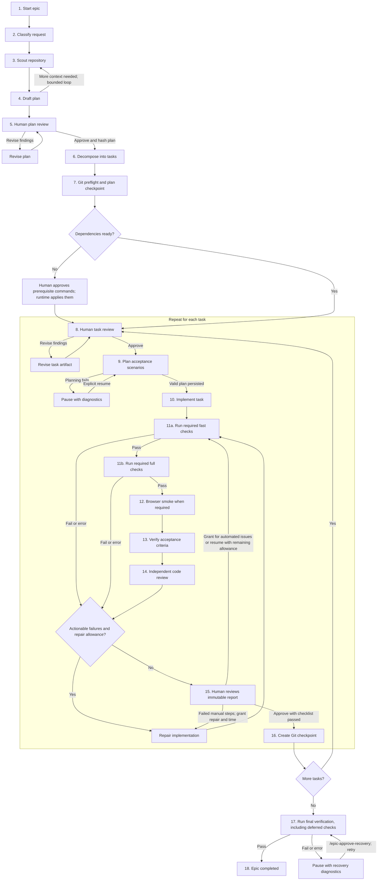

# Epic workflow

An epic runs tasks sequentially, with human approval before implementation and after verification. See [Deterministic Pi epic](pi-epic.md) for configuration, commands, and artifact details.

| Step | Description |
| --- | --- |
| 1. Start epic | `/epic <epic>` creates the run and saves the request in `Epic.md`. |
| 2. Classify request | Assign a complexity label: `complex` if the request contains “migration” (case-insensitive), otherwise `simple` for fewer than 140 characters or `moderate`. |
| 3. Scout repository | Gather read-only evidence about the code, constraints, and available checks. |
| 4. Draft plan | Write the run's `plan.md`; request focused scouting if evidence is missing. |
| 5. Human plan review | Resolve `R:` comments through revision; `/plan-approve` validates and hashes the approved plan. |
| 6. Decompose into tasks | Task Planner turns the approved plan into ordered task artifacts with criteria and check policies. |
| 7. Prepare prerequisites | Require an existing Git worktree and configured identity, ensure diagnostic artifacts are untracked, prepare ignore rules, and create the plan checkpoint. Detect missing dependencies; execute proposed prerequisite commands only after `/epic-approve-prerequisites`. Git preflight failures enter recovery before prerequisite discovery. |
| 8. Human task review | Review the task artifact, refine `R:` findings with `/task-review`, and run `/task-approve` before implementation. Approval with unresolved `R:` findings requests revision instead. Task revisions preserve acceptance criteria. |
| 9. Plan acceptance scenarios | Freeze the approved task criteria and have an independent Verifier persist validated scenarios before implementation; invalid JSON or scenario contracts receive bounded corrections. Invocation, timeout, storage, and persisted-criteria failures pause immediately. |
| 10. Implement task | The writable, sandboxed Implementer makes the approved changes. |
| 11. Run required checks | Run task-required fast checks, then full checks. A failed suite blocks later verification stages and triggers repair when actionable and within allowance; otherwise present the human report. Every repair restarts at fast checks. Record deferred checks for final verification. |
| 12. Browser smoke | When `browser-smoke` is required or scenarios need a browser, launch and supervise the Implementer's declared development server and the runtime browser; check readiness and runtime errors. Close both after browser verification. |
| 13. Verify acceptance | Execute planned command and browser scenarios and collect evidence for each criterion. Human-only obligations remain unverified in the automated report. |
| 14. Independent code review | Review the implementation and evidence; actionable failures trigger repairs while shared allowances remain. |
| 15. Human results review | Inspect the immutable report and record manual checklist results. Continue requests fixes for recorded failures and approves when every manual step passes and no actionable failure remains, including incomplete automated evidence. Unchecked steps keep Continue disabled. `/task-repair` grants repairs. Exit hides the dashboard and leaves the task awaiting review. |
| 16. Create checkpoint | Record accepted task changes in Git, then advance to the next task. |
| 17. Final verification | Run repository-wide checks, including checks deferred by individual tasks; failures require recovery approval. |
| 18. Complete epic | Mark the epic completed after final verification passes. |

Repair attempts and infrastructure retries have separate task-wide counters and share a verification deadline across cycles and resumes. Acceptance planning has its own bounded correction batches and does not consume these verification allowances; initial implementation also precedes the verification deadline. Human review pauses the deadline. At the results checkpoint, `/epic-resume` reruns verification with the remaining allowance; `/task-repair` takes no arguments and explicitly adds one repair attempt and five minutes. Failed manual steps and their observations are sent to the Implementer before reverification. An interrupted repair requires an explicit additional grant before another repair can run. Acceptance criteria remain frozen through the normal workflow.

Each report has its own manual checklist, initially unchecked. Failed steps require a nonblank observation and take priority over unchecked steps in the dashboard's Continue action. Every manual step must pass before approval, and actionable failures require repair. Completed manual review can resolve gaps in automated evidence without extra prompts; the report preserves its original findings. Rerunning verification creates a new report and checklist requiring fresh review and acceptance.

The diagram shows the main path and key loops. Operational errors elsewhere also pause with diagnostics or a task report instead of silently advancing. State, events, evidence, and reports persist under `.pi/epics/runs/<epic-id>/`; `/epic-status` shows the pending action, and `/epic-exit` only hides the dashboard.

Source: [epic orchestration](../pi/extensions/epic/machines/epic-machine.ts), [task execution](../pi/extensions/epic/machines/task-execution-machine.ts), [services](../pi/extensions/epic/services.ts), [verification loop](../pi/extensions/epic/verification-runner.ts), [human decisions](../pi/extensions/epic/verification-decisions.ts), and [dashboard submission](../pi/extensions/epic/dashboard/manual-review-submission.ts).
